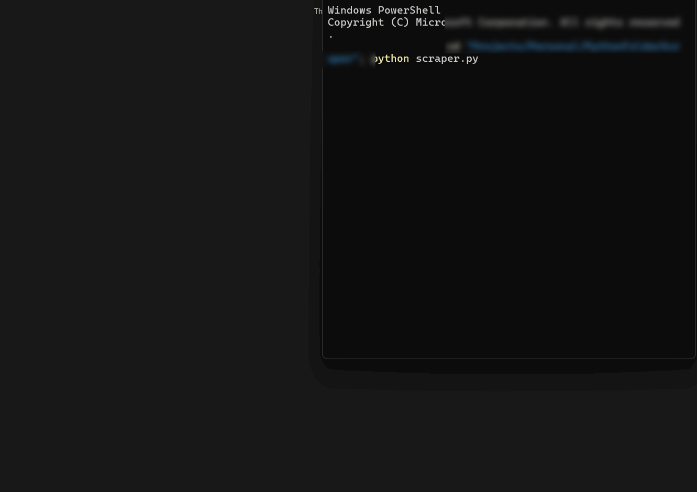

# PythonScrollScraper

A Playwright-based Python scraping script designed to automatically download images from infinite-scrolling websites. 

> **Demonstration**: Below is a hypothetical example of what the script looks like running in action on a site.
> 
> 

## How it works
The script will open a Chromium browser to a target site and infinitely scroll down the page. While scrolling, it intercepts background network requests directed to the image backend, and directly downloads them to a dynamically created folder `~\Downloads\ImageScraper` on your computer.

The script tracks how many downloads happened in the current session. To prevent indefinite fetching when scrolling is exhausted, it is configured to auto-stop once it hits a configurable limit (default: 10) of consecutive duplicate images.

## Setup

```powershell
pip install playwright
playwright install
```

## Usage

Simply run the script:

```powershell
python scraper.py
```

The script will handle folder creation, browser startup, downloads, and automatic termination once duplicates are found. You can also press `Ctrl+C` to cancel it early.
